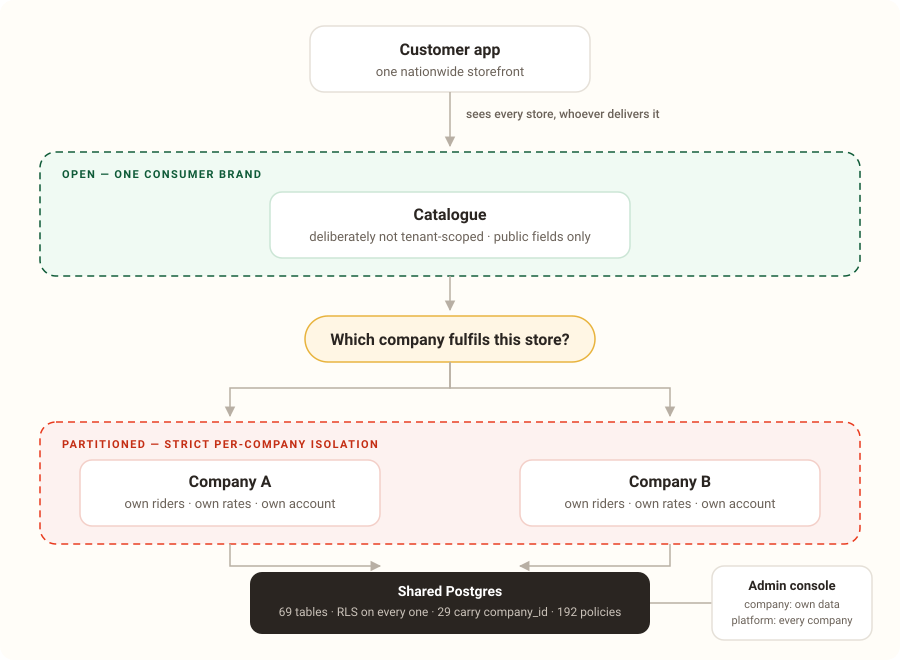
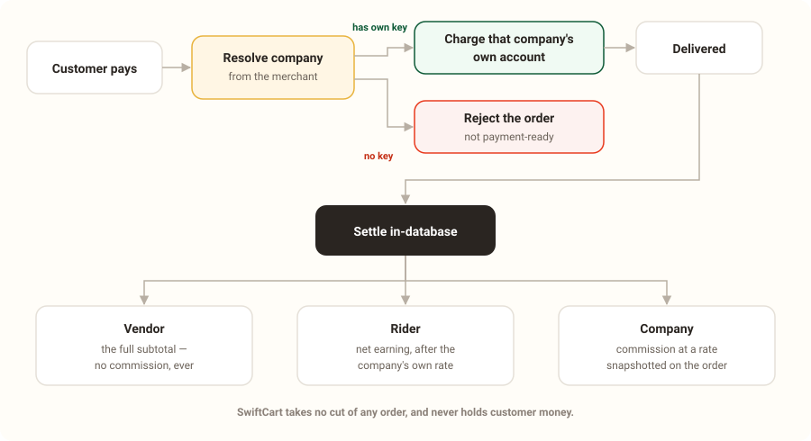

  

<h1 align="center">SwiftCart</h1>

  <b>A nationwide delivery marketplace for Nigeria — and the multi-tenant platform that runs it.</b> 
  Four apps, one design system, one shared Postgres backend. Designed and built solo.

  <a href="https://swiftcartapp.co">swiftcartapp.co</a> ·
  <a href="docs/case-study.md">The case study</a> ·
  <a href="docs/architecture.md">Architecture</a> ·
  <a href="docs/design-system.md">Design system</a>

---

Customers open one SwiftCart-branded app and see every shop near them — restaurants, pharmacies, supermarkets, minimarts — sorted by distance. Behind each shop sits an independent, licensed local delivery company that supplies the riders, holds its own payment account, and sets its own rates. Customers never see which company delivers for them, and never need to.

SwiftCart is not the delivery company. It is the consumer brand and the software, licensed to the operators.

> **Status: pre-launch.** Not yet in public app stores. The system runs end to end — 29 orders have been carried through payment, dispatch, delivery and settlement in the live environment — but this is pilot volume, not traction. The three companies currently on the platform are seeded tenants used to prove isolation, not signed operators.

---

## The constraint that became the business model

SwiftCart was built as a single-operator marketplace: its own riders, its own vendors, four production apps, a full operational backend. Then it hit a wall.

**Taking customer payments in Nigeria requires an operating licence that unlocks a payment account. SwiftCart could not obtain one.** A finished marketplace could not legally collect a naira.

The two obvious responses were both bad — wait indefinitely for a licence outside my control, or throw away a working system to rebuild as something smaller.

The third option came from noticing the problem was not mine alone. **There are licensed delivery companies with payment accounts, riders on the road, and no software worth using.** SwiftCart had the software and no licence. The two are exactly complementary.

So the product was inverted. SwiftCart stopped being an operator and became a platform: licensed companies bring the licence, the riders and the payment account; SwiftCart brings the apps, the consumer brand and the customers.

|  | Before | After |
|---|---|---|
| **Position** | Single operator, blocked on a licence | Software licensed to any number of licensed operators |
| **Customer money** | SwiftCart holds all of it | SwiftCart holds **none** |
| **Revenue** | Order commission — unobtainable | Fixed company subscriptions |
| **Costs** | Scale with order volume | Roughly fixed |
| **Growth** | Consumer acquisition | Sign licensed companies |

The constraint didn't shrink the product. It clarified what the product actually was: not a delivery company, but the software and the demand behind many of them.

**→ [Read the full case study](docs/case-study.md)** — including the live-database migration, the security rehearsal, and the ten minutes it took down merchant reads.

---

## The four-sided system

| | | |
|---|---|---|
| **Customer** | One nationwide storefront — browse, pay, live-track, earn loyalty. Always SwiftCart-branded. | 51 screens |
| **Vendor** | The shop console — orders, inventory, expiry alerts, promotions, payouts. | 65 screens |
| **Rider** | Jobs, a guided delivery flow, net take-home, withdrawals. **White-labelled** per company. | 51 screens |
| **Admin** | One app, two faces: a company operations console and a platform-owner console. | 67 screens |

**234 screens · 25 edge functions · 97 migrations · 69 tables, every one under row-level security.**

<!-- SCREENSHOTS: drop images into assets/screenshots/ and uncomment.

  

-->

---

## What I designed and built

Every layer, solo — product strategy, brand, design system, four apps, the shared backend, the security model, and the marketing site. Every commit across all five repositories is sole-authored.

**Product** — the licensing pivot and the business model · the open-demand/closed-supply tenancy split · invitation-only vendor onboarding · net-only rider earnings · retiring the vendor subscription entirely.

**Design** — the design system shared across four apps (tokens, an 18-variant type scale, motion primitives, a common component vocabulary) · every screen and flow · the brand, from app icon to marketing site · WCAG contrast maths for white-label brand colours.

**Engineering** — React Native / Expo across four apps · a multi-tenant Postgres schema with 192 RLS policies · per-company payment routing · in-database settlement · 25 Deno edge functions.

*Two honest notes: the git history is checkpointed rather than incremental, so the commit graph understates the timeline. And there is no automated test suite — correctness is enforced by server-side validation and manual verification, not by CI.*

---

## The design system

Four apps built by one person drift unless something holds them together. `constants/theme.ts` is that thing, and it opens with the rule it enforces:

> `SwiftCart Design System — shared across all SwiftCart apps.`
> `NEVER use hardcoded colours, sizes, or shadows anywhere.`

It defines the full token set — five Satoshi weights, an 11-step size scale, spacing, layout constants, seven radii, five elevation levels, and ~60 colour tokens named by **role** (`textSecondary`, `dangerLight`, `inputBorderFocused`) rather than by hue, so a brand change never means a find-and-replace.

On top of it sits an **18-variant type scale** in a single `<Text>` component — `h1`–`h5`, three body sizes, labels, captions, `micro`, `display`, buttons — with deliberate backward-compatible aliases (`bodyMd` → `bodySm`, `h5` → the `h4` band) so an older app's screens keep rendering while the system converges.

**A shared component vocabulary repeats across all four apps** — `ScreenHeader`, `ScreenContainer`, `StatusBadge`, `BottomSheet`, `PinnedButton`, `SkeletonLoader`, `NetworkErrorCard`, `TransactionRow`, `OTPInput`, `PhoneInput`, `AppLockGate` — so a rider and a vendor screen are recognisably the same product, built from the same parts.

**Motion is tokenised too** (`utils/motion.ts`): named durations, a press-scale constant, two spring configs, exposed as `useFadeInUp` and `useScalePress`. Interaction feel is a system decision, not a per-screen improvisation.

**States are covered systematically, not decoratively.** Loading, empty, error and refresh handling appears **662 times across 163 files** — skeletons while data loads, an explicit offline card, empty states with a way forward, pull-to-refresh throughout.

**→ [Full design system notes](docs/design-system.md)**

---

## Three decisions worth defending

**1. The storefront is deliberately *not* tenant-scoped.**
Almost everything in the database is partitioned by company. The customer storefront is the exception: a customer sees every approved store nearby regardless of who delivers it, because SwiftCart is a single consumer brand and a fragmented catalogue would be a worse product. I got this wrong in the first pass — scoping customers to companies — and correcting it was one of the more valuable course-corrections in the project. The demand side is open; the supply, money and settlement sides are strictly partitioned. Storefront reads go through one server function that returns only public fields, so an open catalogue can't leak a merchant's phone number or wallet balance.

**2. Role and scope are separate ideas.**
*Role* (`super_admin`, `ops`, `support`, `finance`) decides which **actions** you can take. A separate flag decides whose **data** you can see. This matters because a delivery company's own admin legitimately holds `super_admin` over *their* company — so platform-only screens gate on **scope, never role**. Getting this backwards is how a tenant walks into the platform's data.

**3. Riders see take-home, never gross.**
A rider is never shown the delivery fee or the commission — only what lands in their wallet, computed from their own company's rate. It removes an entire category of "why is my pay different from the fee I saw?" disputes. It's enforced through one shared helper used consistently across the app, so no screen can accidentally show a gross figure.

---

## How it works

  

**Money never pools.** At checkout the server resolves the store's company and charges through *that company's own* payment account. The client holds no payment key. The payment function **refuses to fall back to the platform account** for a company that hasn't configured its own — a keyless company is reported as not payment-ready and the order is rejected, rather than silently routing a customer's money into the wrong account.

  

The commission rate is frozen onto the order at delivery, so a company changing its rate later never rewrites history.

**Correctness sits on the server.** Delivery fees, stock availability and promotions are all revalidated at order time — the client cannot underpay a fee or buy something out of stock. Bank details and per-company payment keys are encrypted at rest, with only the last four digits ever shown again. Identity documents live in a private, non-listable bucket.

**→ [Full architecture](docs/architecture.md)**

---

## Proving the isolation, rather than assuming it

Multi-tenancy is only real if it holds under attack. Rather than trust that the policies worked, I created a second company on the live database with deliberately different economics and **impersonated every role at the database level** — company admin, rider, platform admin — to see what each identity could actually reach.

It found real leaks that reading the policies had not:

- Any authenticated user of any company could read **every merchant's phone number and wallet balance**.
- A brand-new company's admin could see another company's **products and promotions**.

The pattern was identical each time: a correct company-scoped policy **OR'd with a legacy blanket policy**, which silently defeated it. All were closed and re-verified.

Two things worth generalising. **Automated security linters found none of it** — a linter can see that a policy exists, but not that `auth.role() = 'authenticated'` on a tenant table means "everyone sees everyone." Only simulating a second tenant's traffic exposed it. And **proof beats reasoning**: every isolation claim was checked by impersonation and transactional dry-runs that rolled back, not by inspecting SQL.

One genuine outage happened during the work — a new policy created infinite recursion and took merchant reads down for about ten minutes. It was caught by a dry-run, reverted, the cause written into the migration, and the rule ("a policy on A must not read a B whose policies read A") recorded so it can't recur silently.

---

## Built with

`React Native` · `Expo` (SDK 54) · `expo-router` · `TypeScript` · `Supabase` (Postgres · Row-Level Security · Edge Functions · Storage · Realtime · Vault) · `PostgreSQL` · `Deno` · Paystack (one account per company) · Expo Push · Sentry

Phone-OTP auth for customers, vendors and riders; email + TOTP two-factor for admins; a biometric app-lock across all four.

---

## Repositories

| | |
|---|---|
| **[swiftcart-site](https://github.com/heykoyr/swiftcart-site)** | The marketing site — hand-built, no framework, no build step, WCAG 2.1 AA. **Public.** |
| SwiftCart-customer · vendor · rider · admin | The four apps and the shared backend. **Private — it's a launching commercial product.** Each carries a full README; happy to walk through the code on request. |

## Documentation

| | |
|---|---|
| **[case-study.md](docs/case-study.md)** | The pivot — how a licensing blocker became the architecture |
| [product-overview.md](docs/product-overview.md) | What SwiftCart is, the four apps, how money moves |
| [architecture.md](docs/architecture.md) | Stack, tenancy, security, settlement, company lifecycle |
| [design-system.md](docs/design-system.md) | Tokens, type scale, motion, components, contrast |
| [monetization.md](docs/monetization.md) | Who pays whom, and why there's no order commission |
| [briefs/](docs/briefs/) | One-page briefs for companies, vendors, riders and customers |

---

  Designed &amp; built by <b>Adekoya Oluwafemi A.</b> — a product of <b>Koyr</b>. 
  <a href="https://heyadkoy.framer.website">Portfolio</a> ·
  <a href="https://www.linkedin.com/in/adkoy">LinkedIn</a> ·
  <a href="mailto:heykoyr@gmail.com">heykoyr@gmail.com</a>

